<h1 align="center">Preference Optimization</h1>

<p align="center">
  <em>Direct Preference Optimization built from scratch: a supervised reference policy, a Bradley-Terry preference dataset, and an exact, hand-derived DPO gradient that aligns the policy to the hidden reward, with zero runtime dependencies.</em>
</p>

<p align="center">
  <a href="https://github.com/adeoluo/preference-optimization/actions/workflows/ci.yml"></a>
  
  
  
  
  
</p>

---

## Motivation

Aligning a language model to human preferences is the central problem of modern
post-training. **Direct Preference Optimization** (Rafailov et al., 2023) replaces the
reinforcement-learning stage of RLHF with a single classification loss on preference pairs: no
reward model to train separately, no rollouts, no clipped policy gradient. It rests on the
insight that the optimal KL-regularized policy has a closed form, so the reward can be folded
into the policy itself and fit directly from comparisons. This project implements the whole
pipeline **from first principles** on a tractable alignment task: a supervised reference fit by
**behavior cloning**, a **Bradley-Terry** preference dataset, and the **exact DPO gradient**,
all with **zero runtime dependencies** and no automatic differentiation.

## Architecture

<p align="center">
  
</p>

A hidden gold reward defines the truth. A low-temperature teacher produces demonstrations that
a reference policy is cloned from, and a Bradley-Terry annotator produces noisy preferences
that DPO optimizes. The learner never sees the reward. See the [ADRs](docs/adr/) for the key
decisions.

## The method

DPO aligns a policy `p` toward a frozen reference `q` using preference pairs. For a chosen
response `w` and a rejected response `l` under prompt `x`, with regularization strength `beta`,
define the margin

```
m = beta * [ (log p(w|x) - log q(w|x)) - (log p(l|x) - log q(l|x)) ]
```

and minimize `-log sigmoid(m)`. The reward that DPO implicitly fits is `beta * log (p / q)`.
For the log-linear policy used here the expected-feature terms in the two log-probability
gradients cancel, so the loss gradient is exactly

```
dL/dtheta = -sigmoid(-m) * beta * (phi(x, w) - phi(x, l)),
```

which this project implements directly. The pipeline has three stages: behavior cloning fits
the reference by penalized maximum likelihood, the preference data is sampled from a
Bradley-Terry annotator, and DPO aligns a copy of the reference.

## Results

> Reproduce with `python -m preference_optimization evaluate`. All metrics are computed against
> the hidden gold reward, which the learner never observes.

| Metric | Value |
|---|---:|
| **reward gap closed (reference to optimal)** | **86.1%** |
| expected reward (reference to aligned) | 0.589 to 1.067 (optimal 1.144) |
| held-out preference accuracy | 0.863 |
| win-rate versus reference | 0.645 |
| implicit reward versus true reward (Pearson) | 0.767 |
| mean KL to reference | 0.782 |

Starting from a partially aligned supervised reference, DPO **closes 86 percent of the reward
gap to the optimal policy** while staying close to the reference in KL. The reward that DPO
never saw is recovered implicitly: the quantity `beta * log (p / q)` correlates with the true
reward at **r = 0.767**. A sweep over `beta` traces the reward versus divergence frontier
(smaller `beta` aligns harder, see the [evaluation report](docs/EVALUATION_REPORT.md)).

## Demonstration

```text
$ python -m preference_optimization compare
Per-prompt greedy choice (reference -> aligned, with the gold-best response):
  prompt 0: reference r3 -> aligned r1  (gold-best r1, match)
  prompt 1: reference r0 -> aligned r4  (gold-best r4, match)
  ...
```

DPO moves the greedy choice onto the reward-optimal response for prompts where the reference
was wrong, using only noisy pairwise comparisons.

## Quickstart

```bash
git clone https://github.com/adeoluo/preference-optimization.git && cd preference-optimization
make setup                    # install dev tooling + pre-commit hooks
make all                      # lint + type-check + test

python -m preference_optimization evaluate        # full pipeline and alignment report
python -m preference_optimization compare         # greedy choice before and after DPO
```

Use the pieces directly:

```python
from preference_optimization import run_pipeline, PipelineConfig

result = run_pipeline(PipelineConfig(beta=0.3))
print(result.report.format())
```

## Running the service

A dependency-free HTTP service runs the pipeline once at startup and serves alignment queries:

```bash
python -m preference_optimization serve --port 8000

curl localhost:8000/health
curl localhost:8000/report
curl -s -X POST localhost:8000/score -d '{"prompt": 0}'
```

See the [operations guide](docs/OPERATIONS.md) for the service contract and constraints. The
service also exposes `GET /ready` (readiness) and `GET /metrics` (per-route request, error, and
latency metrics in Prometheus text format). A production-style stress benchmark
(`uv run python benchmarks/stress.py`) reports throughput and p50/p95/p99 latency; the scaling
path and tradeoffs are in [docs/SCALING.md](docs/SCALING.md) and a full walk-through is in the
[case study](docs/CASE_STUDY.md).

## Components

- **domain** - the alignment task, the hidden gold reward, the low-temperature teacher, and the
  Bradley-Terry preference annotator.
- **policy** - a log-linear softmax policy with exact distributions, log-probabilities,
  expected features, and sampling.
- **sft** - behavior cloning of the reference by penalized maximum likelihood.
- **dpo** - the DPO loss and the exact, hand-derived gradient, with a training loop.
- **evaluation** - reward, win-rate, preference accuracy, KL, and implicit reward correlation.
- **pipeline** - the end-to-end run from task to aligned policy.

## Design decisions

- **Direct Preference Optimization, not a reward model plus PPO.** A single closed-form loss on
  comparisons, with no separate reward model and no rollouts.
  ([ADR-0002](docs/adr/0002-direct-preference-optimization.md))
- **A log-linear policy with an exact gradient.** The expected-feature terms cancel in the DPO
  gradient, giving a clean, dependency-free implementation that is easy to verify.
  ([ADR-0003](docs/adr/0003-log-linear-policy.md))

## Responsible AI

- **Model card:** [docs/MODEL_CARD.md](docs/MODEL_CARD.md)
- **Data card:** [docs/DATA_CARD.md](docs/DATA_CARD.md)
- **Threat model:** [docs/THREAT_MODEL.md](docs/THREAT_MODEL.md)

## Limitations

- The task is a contextual bandit with a log-linear policy, chosen so every quantity is exact.
  A sequence-level language-model policy would need per-token log-probabilities and automatic
  differentiation.
- Preference data is simulated from a Bradley-Terry annotator over a known reward; real
  annotations carry different and often inconsistent noise.
- DPO can overfit to noisy preferences when `beta` is small and training is long; the reward
  versus divergence tradeoff is documented rather than hidden.

## Roadmap

- [ ] Identity Preference Optimization and a conservative DPO variant
- [ ] A token-level policy with teacher-forced log-probabilities
- [ ] Preference label noise ablations and calibration curves

## License

[MIT](LICENSE). Part of an artificial intelligence engineering portfolio by
[adeoluo](https://github.com/adeoluo).
